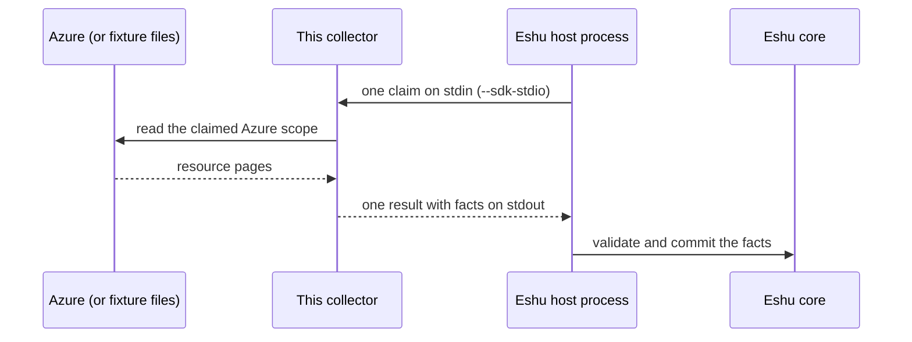

# eshu-collector-azure-cloud

**Status: pre-release.** Eshu core still owns this data in production.
This repo has no authority to publish facts on its own yet.

This collector reads Azure resource data and hands Eshu evidence about
what exists in an Azure scope, how those resources relate, and what
changed, so you can answer which Azure resources Eshu has seen and how
they connect.

A *fact* is one small, typed piece of evidence.
A *claim* is one bounded request to collect one scope.
The *host* is the Eshu process that starts this collector, sends it a
claim, and stores the result.
This collector only collects and returns evidence.
It does not store anything itself.

## What it collects

The table below is generated from `spec.emittedFacts` in
[manifest.yaml](manifest.yaml).
That file declares 8 fact kinds, all at schema version `1.0.0` with
`reported` confidence (the source reported it; Eshu did not measure it
directly).

| Fact kind | Plain meaning |
|---|---|
| `azure_cloud_resource` | One Azure resource seen in the scope |
| `azure_cloud_relationship` | One link between two Azure resources |
| `azure_tag_observation` | Tags seen on one Azure resource |
| `azure_identity_observation` | A managed identity or role assignment seen on a resource |
| `azure_dns_record` | One DNS record seen for an Azure DNS resource |
| `azure_image_reference` | A container or machine image a resource points at |
| `azure_resource_change` | One reported change to an Azure resource |
| `azure_collection_warning` | Part of the scope could not be read fully |

Tag, identity, DNS, and image facts need redaction key material.
Without a redaction key file, those kinds are not emitted.
Sensitive values are fingerprinted or removed before emission, never
passed through raw.

## How it fits in



In text: Azure (or fixture files) -> this collector -> Eshu host
process -> Eshu core.
By default the collector reads checked-in fixture files and makes no
live Azure call.
Live reads need an explicit opt-in, described below.

## When to use it

Use it when Eshu needs evidence about Azure resources in a
subscription, management group, or tenant-level scope, including
their tags, identities, DNS records, image references, and reported
changes.

## When not to use it

- Do not use it as a live Azure browser or reporting tool.
  It returns facts to the Eshu host; it has no user interface.
- Do not expect proven live Azure reads yet.
  Live transport ships behind an explicit opt-in, no tenant-backed
  proof exists yet, and the zero-value live factory fails closed.
- Do not use it for non-Azure clouds or for Azure data-plane
  contents (object data, secrets, or record payloads).

## How Eshu runs it

The host runs one claim per process invocation.
It starts the binary with `--sdk-stdio`, writes one
`collector-sdk/v1alpha1` request to stdin, and reads one result from
stdout.
The host owns admission, identity, storage, and recovery.
This binary never commits facts itself.

```bash
go run ./cmd/collector --sdk-stdio < request.json > result.json
```

Fixture proof is the default mode and makes no live Azure call:

```bash
go run ./cmd/collector \
  --redaction-key-file /path/to/key \
  --generation-id generation-fixture-1
```

The container image repeats the fixture proof with no arguments:

```bash
docker build --platform linux/amd64 -t azure-cloud-collector:local .
docker run --rm --platform linux/amd64 azure-cloud-collector:local
```

[manifest.yaml](manifest.yaml) pins the Linux amd64 image by digest:
`ghcr.io/eshu-hq/eshu-collector-azure-cloud@sha256:a5dcbc1d4e404ea68a67673c846276f63adb54689e3b6a832b32aeec38df7e29`.
The comment in that file says this is a local-build digest to re-pin
with the registry digest on the first image push.
This binary has no `seed` subcommand; the image entrypoint is the
collector itself (see [Dockerfile](Dockerfile)).

## Configuration

[config.example.json](config.example.json) shows the source shape.
In host mode the request carries `protocol_version`, the host claim,
and `config.source` with the fields below.

| Name | Required | Default | Meaning |
|---|---|---|---|
| `collector_instance_id` | Yes | Flag default `azure-instance-1` in local mode | Instance that owns target policy |
| `targets` | Yes, at least one | None | Bounded Azure scope shards to read |
| `targets[].tenant_id` | Yes | None | Azure tenant for the shard |
| `targets[].scope_kind` | Yes | None | `subscription`, `management_group`, or `tenant` |
| `targets[].provider_scope_id` | Yes | None | Subscription, management group, or tenant identifier |
| `targets[].resource_type_family` | No | Empty means whole scope | Provider namespace filter, such as `microsoft.compute` |
| `targets[].location_bucket` | No | Empty means all locations | Azure location filter, such as `eastus` |
| `targets[].credential_ref` | For live reads | None | Name of the read-only credential; never a secret value |
| `targets[].source_uri` | No | `https://management.azure.com/` | Credential-free source address recorded on facts |
| `targets[].source_lane` | No | `resource_graph` | Read lane; `resource_changes` and `arm_fallback` are fixture-only |
| `targets[].fencing_token` | No | `1` | Ordering token so a stale run cannot replace newer facts |
| `fixture_pages` | No | `testdata/resources_page1.json,testdata/resources_page2.json` via `--pages` | Fixture files to read instead of Azure |
| `live` | No | `false` | Explicit opt-in to live Azure reads |
| `redaction_key_file` (`--redaction-key-file`) | No | Empty | Path to read-only key material; enables tag, identity, DNS, and image facts |
| `limits.max_records_per_claim` | No | `10000` | Maximum facts in one claim |
| `limits.max_payload_bytes` | No | `1048576` | Maximum bytes in one fact payload |
| `limits.claim_timeout_seconds` | No | `300` | Maximum wall-clock seconds for one claim |

Local flags mirror the limits: `--max-records`,
`--max-payload-bytes`, and `--claim-timeout-seconds`.
Zero selects the default; negative values fail.

## Credentials and least privilege

Config names a credential with `credential_ref`; it never holds a
secret value.
For live reads, the collector resolves that name from the ambient
workload identity (the identity of the running workload) and fails
closed otherwise.
Credential names and values are never read from fixture config into
facts and never logged.
This repo does not name a specific Azure role or policy, so grant the
named credential only the read access the claimed scope needs and
stop there; do not copy a role recommendation from another repo.

## Claim budget and operator signals

One claim is bounded by the limits above (defaults: 10,000 records,
1,048,576 payload bytes per fact, 300 seconds).
A run that passes a bound fails instead of returning late or
oversized evidence.
Each run writes one health line to stderr with the effective limits,
whether the run was fixture-only, the fact and warning counts, the
last success time and digest, or a bounded failure class.
The health line never carries Azure IDs, names, tags, query text,
URLs, or credential names.
The manifest declares the metric prefix `eshu_dp_azure_`; treat the
stderr health line as the operator signal proven by the code here.

## Eshu dependencies

| Dependency | Version or contract | Source |
|---|---|---|
| `github.com/eshu-hq/eshu-sdk/collector` | `v0.2.0-rc.3` | `go.mod` |
| `github.com/eshu-hq/eshu-sdk/factschema` | `v0.1.0-rc.12` | `go.mod` |
| Host protocol | `collector-sdk/v1alpha1`, `process` adapter | [manifest.yaml](manifest.yaml) |
| Eshu core compatibility | `>=0.0.5 <0.2.0` | [manifest.yaml](manifest.yaml) |
| Producer identity | `dev.eshu.collector.azure-cloud`, version `0.1.0` | [manifest.yaml](manifest.yaml) |

`github.com/eshu-hq/eshu-sdk/wirecontract v0.1.0-rc.1` was recorded
in the previous README as not imported; it is not in `go.mod`.

## What this never does

- It never writes to the Eshu graph, Postgres, or any queue.
  It imports no core storage handle; the host validates and commits.
- It never commits facts or decides final truth.
  Its manifest declares reducer phase `source_evidence_only:no_graph_truth`.
- It makes no live Azure call by default, and no test does either.
- It never reads a credential value from config or logs one.

## Build, test, and release

```bash
make ci
```

`make ci` runs `make lint`, `make test`, and `make race` (see
[Makefile](Makefile)): vet, lint and format checks, module drift,
the 500-line file cap, the full test suite, and the race suite.
See [CONTRIBUTING.md](CONTRIBUTING.md) for the coverage floor, which
may only rise.
Releases: `version` in [manifest.yaml](manifest.yaml) and the git
tag must match (`v0.1.0` for `0.1.0`).
Pushing a `v*` tag on the protected `main` head runs the release
workflow, which builds, signs, and publishes the image with SBOM and
provenance attestations.
Any other tag fails before anything builds or pushes.
Artifacts stay digest-pinned (`@sha256:...`, never `:latest`
in the manifest).

## Docs and related repos

- [PORT_PLAN.md](PORT_PLAN.md) — where the in-core source came from
- [NOT_PORTED.md](NOT_PORTED.md) — what stays in Eshu core
- [eshu](https://github.com/eshu-hq/eshu) — Eshu core
- [eshu-sdk](https://github.com/eshu-hq/eshu-sdk) — collector and fact-schema contracts
- [eshu-deploy](https://github.com/eshu-hq/eshu-deploy) — deployment charts and activations

## Contributing, security, and license

See [CONTRIBUTING.md](CONTRIBUTING.md) before opening a change.
There is no `SECURITY.md` and no `LICENSE` file in this repo.
Source files carry `SPDX-License-Identifier: MIT` headers.
