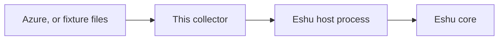
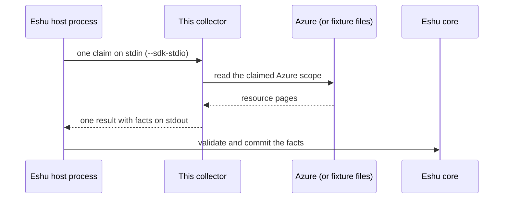
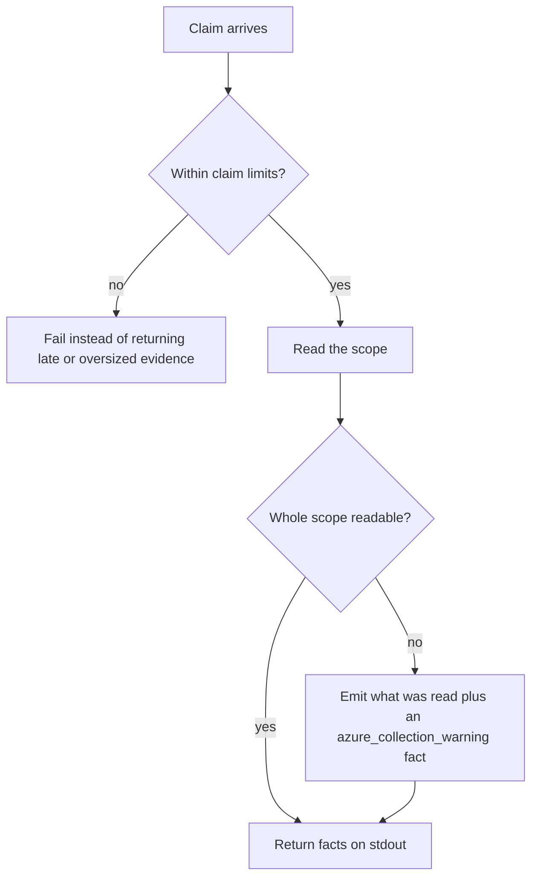

# Diagrams

Every diagram for this collector lives on this page, each with a
caption and a plain-text version so nothing depends on rendering.
Other pages link here instead of copying a diagram. (The repo
[README](../../README.md) keeps the first one as its overview.)

## 1. Where it sits

*Caption: source data flows into this collector, then to the Eshu
host process, then to Eshu core. The collector itself stores
nothing.*

Text version: Azure (or fixture files) -> this collector -> Eshu host
process -> Eshu core.

## 2. One claim, start to finish

*Caption: one process invocation serves exactly one claim. The host
writes the request, the collector reads the claimed scope, facts
come back on stdout, and the host validates and commits.*

Text version: the host writes one `collector-sdk/v1alpha1` request to
stdin, the collector reads the claimed scope and builds facts, then
writes one result to stdout. The host validates and commits.
One process invocation serves exactly one claim.

## 3. When something goes wrong

*Caption: the failure paths. Bounded, fail-closed outcomes are
preferred over late, oversized, or silently incomplete evidence;
partial reads say so instead of pretending.*

Text version: a run that passes a limit fails rather than returning late
or oversized evidence. A scope that can't be read fully still
returns what was read, marked with an `azure_collection_warning`
fact. Live reads fail closed too: the zero-value live factory
refuses to run, and credential resolution fails closed when the
ambient workload identity isn't there.
